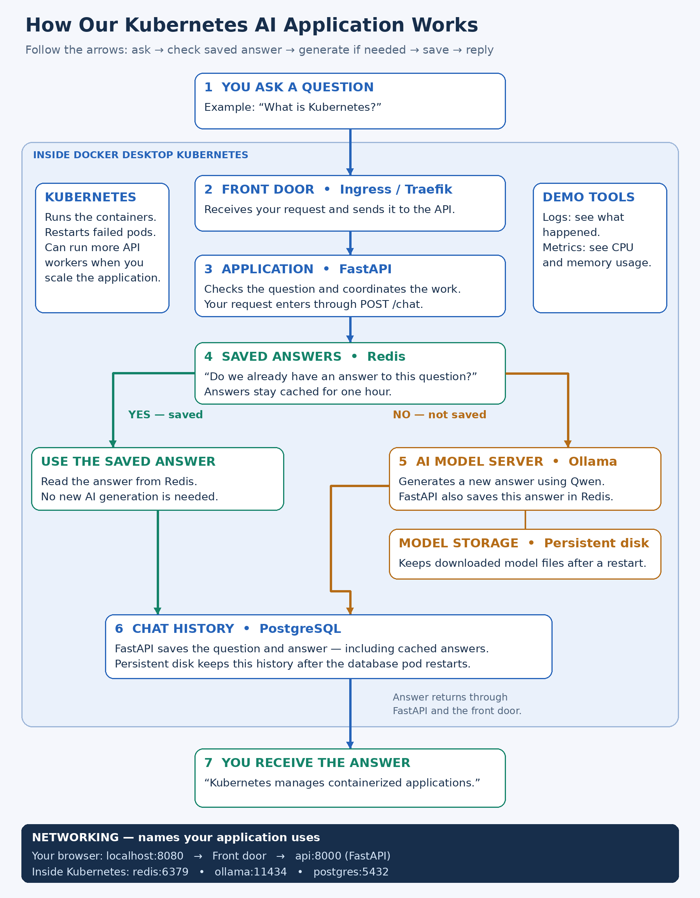
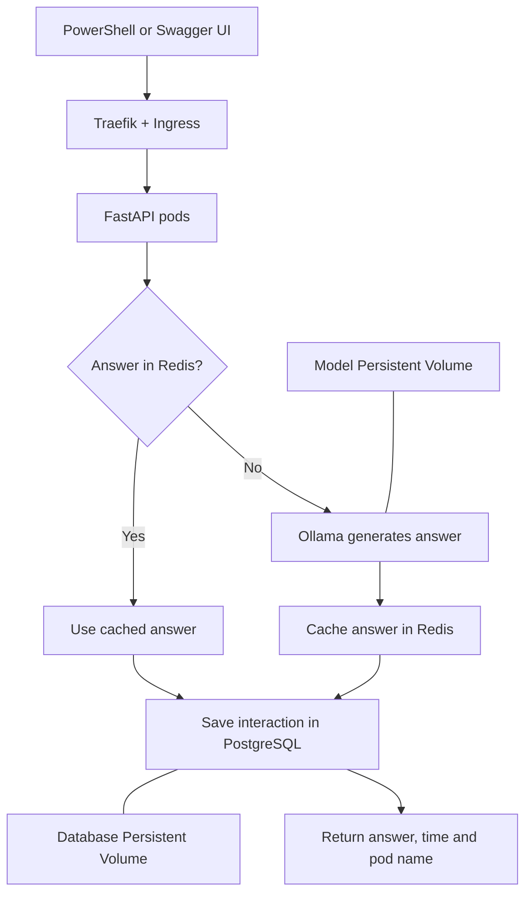

# End-to-End Kubernetes AI Deployment — simple business demo

## Application_Architecture


Run a small open-weight language model on **Docker Desktop Kubernetes** with FastAPI, Redis, PostgreSQL, Ingress, and persistent storage. No cloud account or paid LLM API key is needed. Initial setup downloads container images, Python packages, and the model from the internet.

**Start here:** follow sections 1–8 in order. All commands below use Windows PowerShell. Run commands from the extracted project folder. The application logic is in one commented file, `app.py`.

## What each component does

| Component | Job in this project | Business explanation |
|---|---|---|
| Ollama + Qwen 2.5 0.5B | Generate answers on CPU | Runs the AI model locally |
| FastAPI | Validate questions and coordinate requests | Provides the application API |
| Redis | Cache exact repeated questions for one hour | Avoids repeated model work |
| PostgreSQL | Store questions, answers, times, cache flags and pod names | Keeps a durable interaction record |
| Kubernetes | Run and restart containers; scale API replicas | Manages the application |
| Traefik + Ingress | Route HTTP traffic to healthy API pods | Provides one entry point |
| PersistentVolumeClaims | Request storage for model files and database | Keep data when a pod is recreated |

This is a local teaching MVP. It has no login or TLS and `/history` shows the last 20 requests across all callers. Use non-sensitive sample questions. It is not a production service. History is stored for display, but is NOT sent to the model as conversation memory.

## Application flow



Setting `use_cache` to `false` bypasses both Redis reads and writes for that request. Each successful call still writes a PostgreSQL record.

## Files to explain to the team

| File | Purpose |
|---|---|
| `app.py` | All API application logic |
| `requirements.txt` | Five direct Python dependencies |
| `Dockerfile` | Package Python and application into an image |
| `k8s/00-namespace.yaml` | Separate demo resources into `ai-demo` |
| `k8s/01-storage.yaml` | Model and database storage claims |
| `k8s/02-postgres.yaml` | Database, SQL table initialization and Service |
| `k8s/03-redis.yaml` | Shared cache and Service |
| `k8s/04-ollama.yaml` | Model server and its persistent mount |
| `k8s/05-api.yaml` | FastAPI Deployment, settings, probes and Service |
| `k8s/06-ingress.yaml` | Traefik controller, permissions and Ingress route |
| `k8s/metrics-local-patch.yaml` | Optional local certificate workaround |
| `CODE_WALKTHROUGH.md` | Plain-English explanation of application code |
| `DEMO_SCRIPT.md` | Short presentation sequence and talking points |

## 1. Prepare Docker Desktop

1. Start Docker Desktop with **Linux containers**.
2. Enable Kubernetes. In recent Docker Desktop versions, use **Kubernetes → Create cluster**. In older versions, use **Settings → Kubernetes → Enable Kubernetes → Apply & Restart**.
3. For this walkthrough, choose the **kubeadm / single-node** provisioner if choosing a new cluster. It avoids an extra image-loading step. Do not reset an existing cluster just for this demo; see the image fallback under Troubleshooting if needed.
4. Suggested starting allocation: **4 CPUs, 8 GB RAM available to Docker, 15 GB free disk**. A 16 GB host is more comfortable. These are planning estimates, not measured minimums. On WSL 2, Docker memory/CPU availability may be controlled by WSL settings rather than Docker sliders.
5. Wait until Kubernetes is running. Kubernetes 1.31+ is the target for the Metrics Server version used below.

```powershell
docker version
kubectl version --client
kubectl config use-context docker-desktop
kubectl get nodes
kubectl get storageclass
```

Expected: the node is `Ready`, and a StorageClass is marked `(default)`. Docker Desktop normally supplies a default storage provisioner. Do not continue with missing storage or a non-ready node.

**Explain:** Docker builds images; Kubernetes runs containers from those images. A pod is the smallest unit Kubernetes runs. A Deployment maintains the number of pods we request. A Service provides a stable address for those pods.

## 2. Extract and build the API image

Extract the ZIP, open PowerShell in the folder that contains `app.py`, and run:

```powershell
# Change this path to your extracted folder.
cd E:\end-to-end-kubernetes-ai
Get-ChildItem
docker build -t k8s-ai-api:1.0 .
docker images k8s-ai-api
```

Expected: an image tagged `k8s-ai-api:1.0`. The first build needs internet access. You do not need to install Python on Windows: the Docker image includes Python 3.11.

The manifest uses `imagePullPolicy: IfNotPresent`, so Kubernetes can reuse an image visible to its runtime. Docker Desktop image availability varies with provisioner and image store. If you get `ErrImagePull` or `ImagePullBackOff`, use the fallback below.

## 3. Create namespace, password and persistent storage

```powershell
kubectl apply -f k8s/00-namespace.yaml

# Generates a local demo database password without putting it in a source file.
$dbPassword = [guid]::NewGuid().ToString('N')
kubectl create secret generic database-password --from-literal=password=$dbPassword -n ai-demo
Remove-Variable dbPassword

kubectl apply -f k8s/01-storage.yaml
kubectl get pvc -n ai-demo
```

Create the Secret once. If it already exists from this project, keep it and skip password creation. Changing the Secret does not change a password inside an already initialized PostgreSQL volume.

**Explain:** A PVC is a request for persistent disk. Docker Desktop's default StorageClass provisions the actual PV. We do not need a hard-coded Windows drive path or a hand-written hostPath PV. A claim may remain `Pending` until a pod uses it, depending on the StorageClass.

## 4. Start PostgreSQL, Redis and Ollama

```powershell
kubectl apply -f k8s/02-postgres.yaml
kubectl apply -f k8s/03-redis.yaml
kubectl apply -f k8s/04-ollama.yaml

kubectl rollout status deployment/postgres -n ai-demo --timeout=300s
kubectl rollout status deployment/redis -n ai-demo --timeout=300s
kubectl rollout status deployment/ollama -n ai-demo --timeout=600s
kubectl get pods -n ai-demo
kubectl get pvc -n ai-demo
kubectl get pv
```

Expected: three ready pods and two `Bound` claims. Downloading images can take several minutes. If a timeout occurs, inspect the pod events before continuing.

PostgreSQL runs the mounted `init.sql` script only on its first initialization of an empty volume. This creates the `chats` table. Redis is intentionally disposable: losing a cache entry simply means generating that answer again.

## 5. Download the model once

```powershell
kubectl exec -n ai-demo deployment/ollama -- ollama pull qwen2.5:0.5b
kubectl exec -n ai-demo deployment/ollama -- ollama list
```

Wait for the pull to finish. `ollama list` should show `qwen2.5:0.5b`.

The small model is suitable for showing the deployment flow; answer quality is limited. The demo uses CPU and does not assume GPU passthrough. The downloaded files live at `/root/.ollama`, which is mounted from `ollama-models`. The Docker image contains Ollama; the model is downloaded separately.

## 6. Start FastAPI and the Ingress controller

```powershell
kubectl apply -f k8s/05-api.yaml
kubectl apply -f k8s/06-ingress.yaml

kubectl rollout status deployment/api -n ai-demo --timeout=300s
kubectl rollout status deployment/traefik -n ai-demo --timeout=300s
kubectl get pods,services,ingress -n ai-demo
```

Expected: five ready pods — postgres, redis, ollama, api, traefik. The API readiness check verifies Redis, the database table, and the downloaded model. A running Ollama pod alone does not prove a model has been downloaded.

An Ingress resource is the routing rule; Traefik is the controller that implements it. Both are included. This route accepts any HTTP host so no hosts-file edit is required.

### Terminal A: open the entry point and leave it running

```powershell
kubectl port-forward -n ai-demo service/traefik 8080:80
```

Expected: `Forwarding from 127.0.0.1:8080 ...`. This occupies the terminal; open **another PowerShell terminal** for requests. Press Ctrl+C only when finished.

Traffic goes through the Traefik controller and the Ingress rule. We forward to Traefik, not to a single API pod, so requests can reach different API replicas during the scaling demo. An empty Ingress ADDRESS field is normal with this local ClusterIP/port-forward setup.

## 7. Send a chat question

### Terminal B: health and first request

```powershell
$base = 'http://localhost:8080'
Invoke-RestMethod "$base/health"

$body = @{question='Explain Kubernetes in two short sentences.'; use_cache=$true} | ConvertTo-Json
$first = Invoke-RestMethod -Method Post -Uri "$base/chat" -ContentType 'application/json' -Body $body -TimeoutSec 360
$first | Format-List
```

The first request loads the model into memory and may be slow. Do one warm-up request before presenting. Expected fields:

```json
{
  "answer": "A model-generated explanation...",
  "cached": false,
  "seconds": 12.345,
  "pod": "api-example-pod",
  "model": "qwen2.5:0.5b"
}
```

These values are illustrative; answers, timings and pod names vary. If you already asked the exact question within an hour, `cached` may already be `true`.

### Repeat the exact request

```powershell
$second = Invoke-RestMethod -Method Post -Uri "$base/chat" -ContentType 'application/json' -Body $body -TimeoutSec 360
$second | Format-List
$first, $second | Select-Object cached, seconds, pod
```

Expected: the second response has `cached=True` and usually takes much less time. It avoids an Ollama generation call. Cache matching is exact after trimming surrounding whitespace; different wording is a different key.

### Show stored history

```powershell
Invoke-RestMethod "$base/history" | ConvertTo-Json -Depth 5
kubectl exec -n ai-demo deployment/postgres -- psql -U demo -d aidemo -c 'SELECT id, question, cached, pod, created_at FROM chats ORDER BY id DESC LIMIT 5;'
```

Both successful chat requests appear in the history, including the cached one.

### Optional browser demonstration

Open **http://localhost:8080/docs**. Expand **POST /chat → Try it out**, enter this body, and select **Execute**:

```json
{"question":"What is a container?","use_cache":true}
```

The Swagger page is provided by FastAPI; a separate frontend is unnecessary for this demo.

## 8. Scale the API from one pod to three

```powershell
kubectl scale deployment/api --replicas=3 -n ai-demo
kubectl rollout status deployment/api -n ai-demo --timeout=180s
kubectl get pods -n ai-demo -l app=api

# Through Ingress, check which API pod answers each request.
1..12 | ForEach-Object { (Invoke-RestMethod "$base/health").pod }
```

Expected: three API pods, with multiple pod names appearing in the responses. Exact ordering is not guaranteed. Redis and PostgreSQL are shared by all API pods.

Now repeat the same chat request several times to show the shared cache:

```powershell
1..6 | ForEach-Object {
    Invoke-RestMethod -Method Post -Uri "$base/chat" -ContentType 'application/json' -Body $body -TimeoutSec 360
} | Select-Object cached, seconds, pod
```

**Say:** “We increased the number of API workers without changing the client URL. All workers share the cache, database and model service.”

This is **manual horizontal scaling**. It does not add nodes, provide machine-level high availability, or triple LLM speed. Ollama remains a single CPU-backed model server and can be the bottleneck. No autoscaler is installed in this minimal project.

Scale back after the demo:

```powershell
kubectl scale deployment/api --replicas=1 -n ai-demo
```

## 9. Show logs

```powershell
kubectl logs -n ai-demo -l app=api --all-containers=true --prefix=true --tail=30
kubectl logs -n ai-demo deployment/ollama --tail=30
kubectl logs -n ai-demo deployment/traefik --tail=20
```

API log example: `chat cached=True seconds=0.008 pod=api-...`.

For live logs, use Terminal C:

```powershell
kubectl logs -n ai-demo -l app=api --prefix=true --tail=10 -f --max-log-requests=5
```

Then send a request from Terminal B. Ctrl+C stops log viewing and does not stop the application. The application records latency, cache usage and pod name in logs; it does not log full question/answer text. Database history does store the text.

## 10. Show CPU and memory utilization

First check whether Metrics Server already works:

```powershell
kubectl top nodes
kubectl top pods -n ai-demo
```

If metrics work, skip installation. If Metrics API is unavailable, check whether it is installed:

```powershell
kubectl get deployment metrics-server -n kube-system
```

If not installed, on the target Kubernetes 1.31+ cluster:

```powershell
kubectl apply -f https://github.com/kubernetes-sigs/metrics-server/releases/download/v0.8.1/components.yaml
kubectl rollout status deployment/metrics-server -n kube-system --timeout=180s
```

If it is installed but not ready, inspect its logs first:

```powershell
kubectl logs -n kube-system deployment/metrics-server --tail=50
```

**Only for kubelet certificate verification errors on this local Docker Desktop cluster**, apply the supplied patch once:

```powershell
kubectl patch deployment metrics-server -n kube-system --type=json --patch-file k8s/metrics-local-patch.yaml
kubectl rollout status deployment/metrics-server -n kube-system --timeout=180s
```

This disables kubelet certificate verification for local metrics collection. Do not use this workaround for production. For older Kubernetes versions, choose a compatible Metrics Server release from its official compatibility table instead of blindly using this version.

Allow about one minute for samples, then run:

```powershell
kubectl top nodes
kubectl top pods -n ai-demo
kubectl top pods -n ai-demo --containers
```

**Generate real model work in Terminal B** (cache bypass is important):

```powershell
$liveBody = @{question='Explain five benefits of Kubernetes for a small business.'; use_cache=$false} | ConvertTo-Json
1..5 | ForEach-Object {
    Invoke-RestMethod -Method Post -Uri "$base/chat" -ContentType 'application/json' -Body $liveBody -TimeoutSec 360
}
```

While that runs, sample in Terminal C:

```powershell
1..12 | ForEach-Object { kubectl top pods -n ai-demo; Start-Sleep -Seconds 5 }
```

Explain: `1000m` CPU is one CPU core; `100m` is one tenth of a core. `Mi` is mebibytes of memory. `top` shows sampled usage, not requested capacity. A short request may complete between samples. API CPU can stay low while it waits for Ollama.

To show configured resource requests and limits:

```powershell
kubectl describe deployment ollama -n ai-demo
kubectl describe deployment api -n ai-demo
```

Requests help Kubernetes schedule pods; limits cap their resource usage. These values are chosen for the demo and are not production sizing recommendations.

## 11. Prove model files survive a pod replacement

```powershell
kubectl exec -n ai-demo deployment/ollama -- ollama list
kubectl get pods -n ai-demo -l app=ollama
kubectl rollout restart deployment/ollama -n ai-demo
kubectl rollout status deployment/ollama -n ai-demo --timeout=300s
kubectl get pods -n ai-demo -l app=ollama
kubectl exec -n ai-demo deployment/ollama -- ollama list
kubectl get pvc -n ai-demo
```

Expected: a new Ollama pod name, the same bound claim, and `qwen2.5:0.5b` still listed **without running pull again**. The next request reloads the model into RAM; persistent files do not mean persistent process memory. There is a short interruption while the single Ollama pod restarts.

Optional database proof:

```powershell
kubectl rollout restart deployment/postgres -n ai-demo
kubectl rollout status deployment/postgres -n ai-demo --timeout=180s
kubectl exec -n ai-demo deployment/postgres -- psql -U demo -d aidemo -c 'SELECT COUNT(*) FROM chats;'
```

The count remains. These volumes survive pod replacement; deleting PVCs or resetting Docker Desktop Kubernetes can remove data. A local PV is not an external backup.

## 12. Change the code and redeploy

Edit the system prompt in `app.py`. If you change generation behavior, change the cache-key version from `v1` to `v2` so cached old answers do not hide the change.

```powershell
docker build -t k8s-ai-api:1.1 .
kubectl set image deployment/api api=k8s-ai-api:1.1 -n ai-demo
kubectl rollout status deployment/api -n ai-demo --timeout=180s
```

Also update the image tag in `k8s/05-api.yaml` if you want later `apply` commands to retain it. If using the registry fallback, build, push and set that registry-qualified image instead.

## Troubleshooting

| Symptom | Check / fix |
|---|---|
| Cannot connect to Kubernetes | Start Docker Desktop; enable Kubernetes; select `docker-desktop` context |
| API `ImagePullBackOff` | Image not visible to Kubernetes; use the registry fallback below |
| Other image pull errors | Check internet/proxy/Docker Hub rate limits and pod events |
| `CreateContainerConfigError` | Confirm `database-password` Secret exists in `ai-demo` |
| PVC or pod `Pending` | Check default StorageClass and `kubectl describe pvc`; inspect resource scheduling events |
| API running but not ready | Download the exact configured model; check Redis and PostgreSQL; inspect API logs |
| PostgreSQL password failure after rerun | Keep original Secret with original database volume; changing only the Secret does not rotate the DB password |
| `relation chats does not exist` | Initial SQL runs only on an empty PostgreSQL data volume; initialize the missing table using the command below |
| 404 at `/` | There is no root route; use `/docs`, `/health` or `/chat` |
| 404 on `/health` | Inspect Ingress and Traefik logs; ensure matching `ai-demo-traefik` class |
| 503 from entry point | API pods are not ready; inspect model, DB and cache readiness |
| 504 / slow first answer | CPU model loading is slow; warm up, shorten the prompt and check resource limits |
| Pod `OOMKilled` | Inspect memory usage; increase Docker available memory and relevant container memory limit |
| localhost:8080 unavailable | Keep port-forward terminal open; if port is busy, use `8081:80` and update `$base` |
| Metrics unavailable | Wait for samples; inspect Metrics Server logs and apply local TLS patch only if justified |

Useful diagnosis commands:

```powershell
kubectl get pods -n ai-demo
kubectl get events -n ai-demo --sort-by=.metadata.creationTimestamp
kubectl describe pods -n ai-demo -l app=api
kubectl logs -n ai-demo deployment/api --tail=50
kubectl get secret database-password -n ai-demo
```

If the table is missing but PostgreSQL otherwise works:

```powershell
kubectl exec -n ai-demo deployment/postgres -- psql -U demo -d aidemo -f /docker-entrypoint-initdb.d/init.sql
```

### Image fallback for Docker Desktop kind or a different image store

If the local image cannot be used, publish your code-only demo image to a Docker Hub repository you own. This is optional and requires an account. The supplied Dockerfile copies only `app.py` and `requirements.txt`; do not add secrets to them.

```powershell
docker login
$dockerUser = 'YOUR_DOCKER_HUB_USERNAME'
docker tag k8s-ai-api:1.0 "${dockerUser}/k8s-ai-api:1.0"
docker push "${dockerUser}/k8s-ai-api:1.0"
kubectl set image deployment/api api="${dockerUser}/k8s-ai-api:1.0" -n ai-demo
kubectl rollout status deployment/api -n ai-demo --timeout=300s
```

For the simplest fallback, the repository must be public. Private repositories additionally need an image pull Secret. Update the image in `05-api.yaml` to retain the registry choice. For an already-configured standalone kind installation, `kind load docker-image` is another option, but do not assume it automatically targets Docker Desktop's managed cluster.

## Stop and cleanup

To stop using the app, close port-forward with Ctrl+C. Pods keep running.

To pause workloads while retaining the model and database claims:

```powershell
kubectl scale deployment api ollama postgres redis traefik --replicas=0 -n ai-demo
```

Resume all five at one replica:

```powershell
kubectl scale deployment api ollama postgres redis traefik --replicas=1 -n ai-demo
```

**Full cleanup deletes this project's model files and database history** under the normal default storage reclaim policy. Only run this when you no longer need them:

```powershell
kubectl delete namespace ai-demo
kubectl delete clusterrole ai-demo-traefik
kubectl delete clusterrolebinding ai-demo-traefik
kubectl delete ingressclass ai-demo-traefik
```

Metrics Server is cluster-wide and is deliberately left installed because other workloads may use it. Do not run `kubectl apply -f k8s/` wholesale: the folder also contains an optional JSON patch, which is not a standalone Kubernetes resource. Follow the numbered commands instead.

## Validation and scope

The code was exercised locally with FastAPI's TestClient and mocked dependencies for cache hit/miss/bypass, request validation, database writes, history, readiness and dependency failures. YAML parsing and manifest wiring were checked. Python dependencies installed successfully in the validation environment (Python 3.12); the supplied container targets Python 3.11.

No Docker Desktop cluster is available in the authoring environment, so the image build, live model inference, ingress routing, persistence, scaling and resource metrics still require running this walkthrough on your computer. Example output is illustrative, not a claimed live benchmark.

## Official references

- Docker Desktop Kubernetes setup: https://docs.docker.com/desktop/use-desktop/kubernetes/
- Ollama Docker storage: https://docs.ollama.com/docker
- Ollama generate API: https://docs.ollama.com/api/generate
- Selected model: https://ollama.com/library/qwen2.5:0.5b
- Traefik Kubernetes Ingress provider: https://doc.traefik.io/traefik/v3.6/reference/install-configuration/providers/kubernetes/kubernetes-ingress/
- Persistent volumes: https://kubernetes.io/docs/concepts/storage/persistent-volumes/
- Metrics Server and compatibility: https://kubernetes-sigs.github.io/metrics-server/
